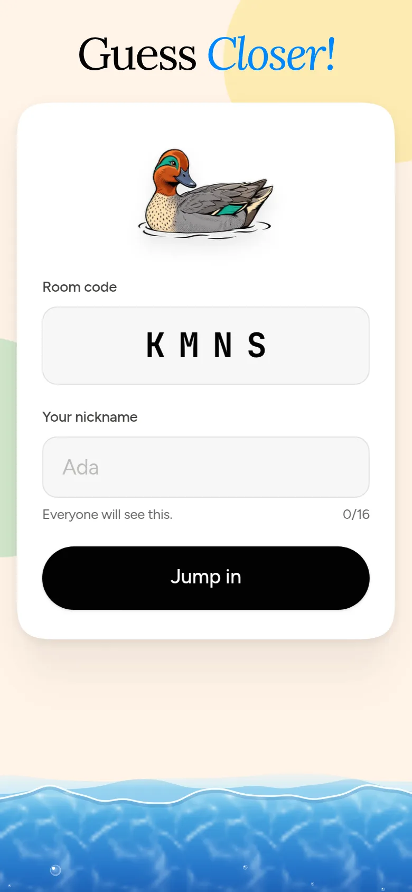
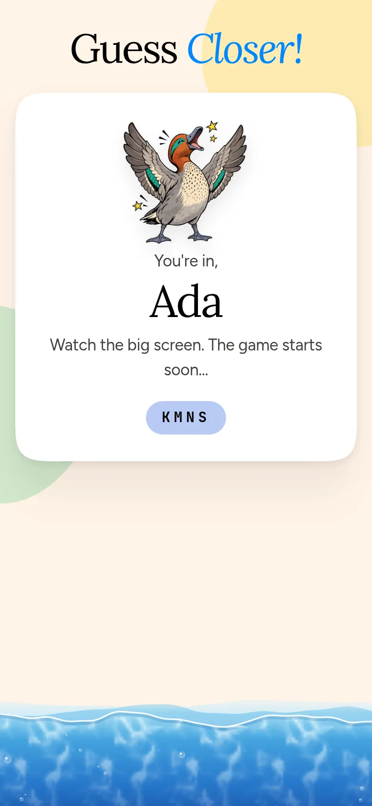
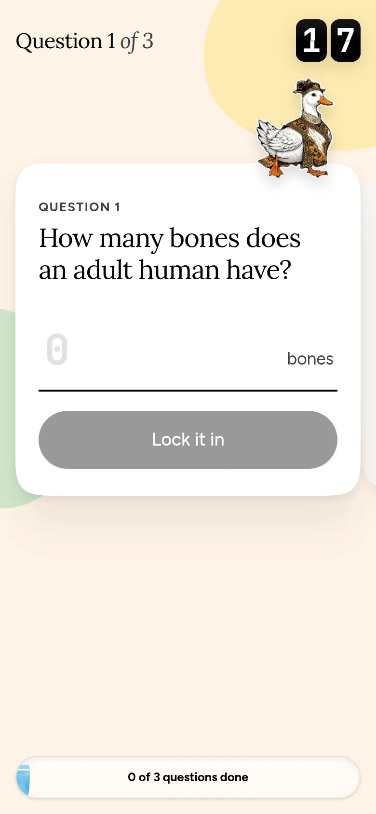
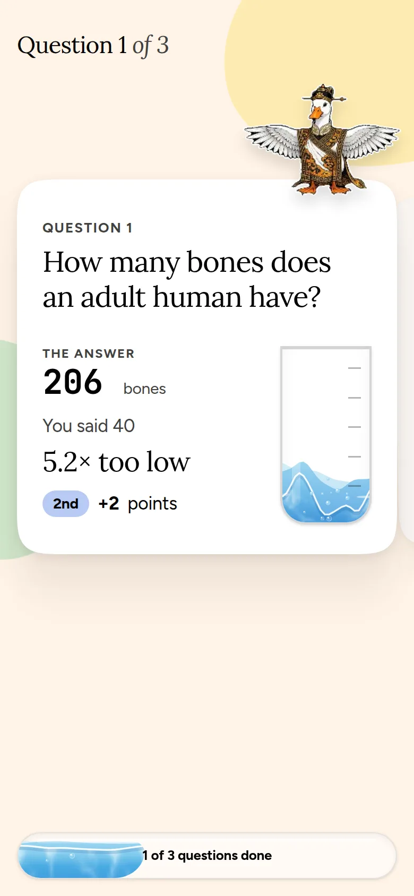
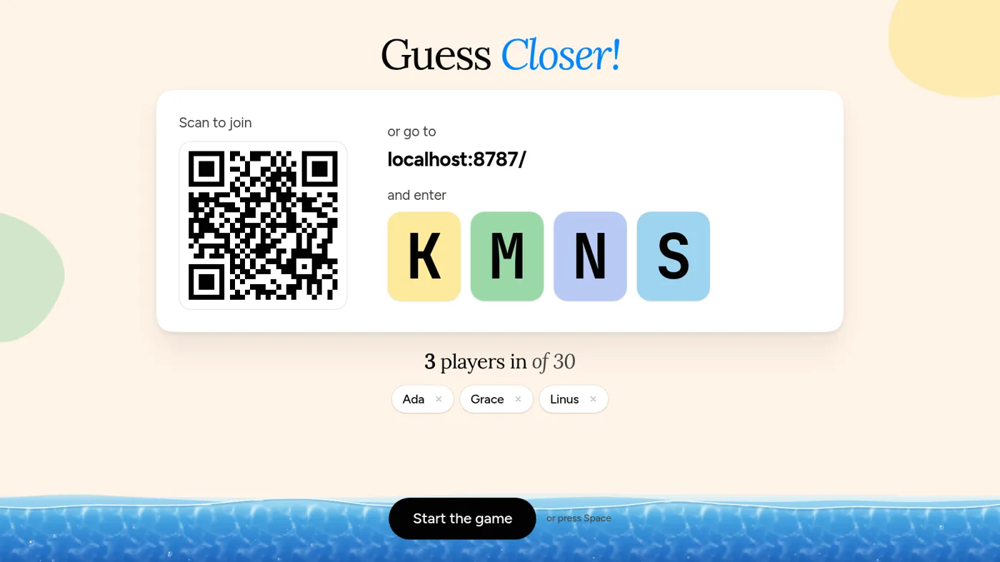
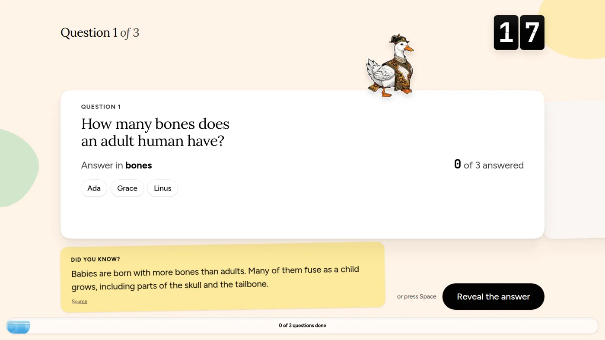
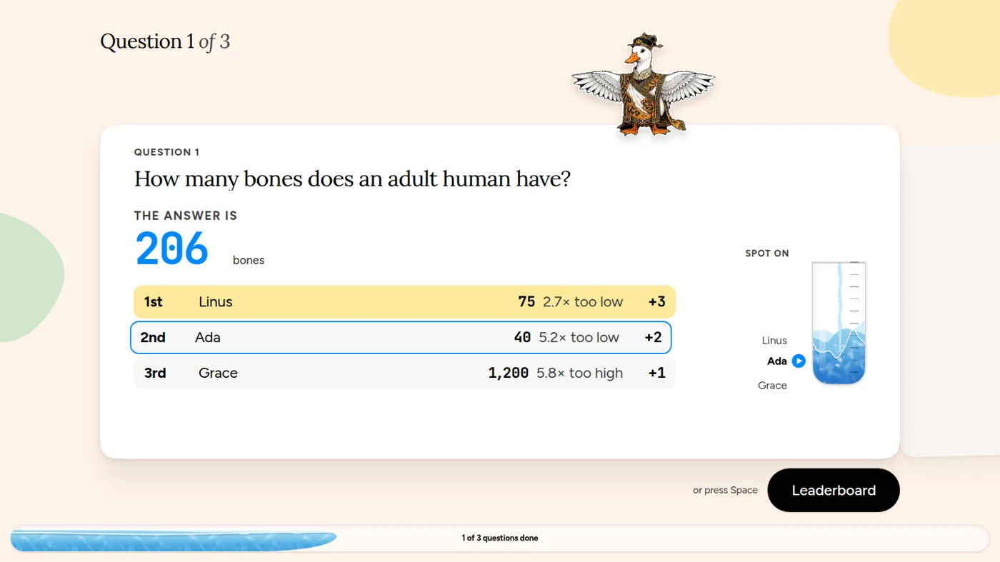
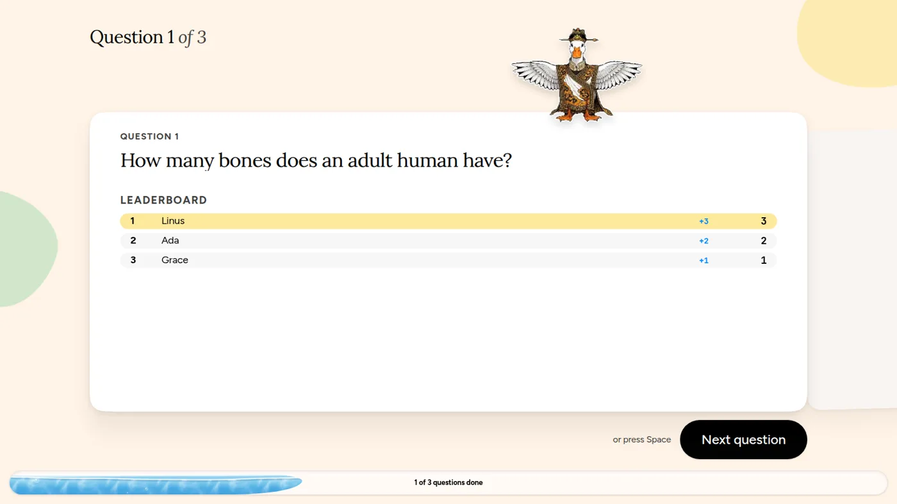

# Guess Closer! (live build)

The game that Delta and the Volunteer built on stage at the [Co-operative Coding Workshop](https://github.com/Delta-43/cooperative-coding-workshop): two people, two AI agents, one repo. It is kept here as an example of what a team and two agents can build in one session. The issues and pull requests from the day are exported in [`docs/history/`](docs/history/), if that folder is present.

Guess Closer! is a live quiz for a room. Players guess numbers on their phones, and the closest guess wins.

- `AGENTS.md`: the short instructions both agents read.
- `PLAN.md`: the goal, the team, the phases and the tasks. The humans own it.
- `DECISIONS.md`: one line per decision.
- `contract/`, `backend/`, `frontend/`: filled in during the workshop, contract first.
- `prompts/`: the prompts each person gives their agent: `frontend-start.md` for the Volunteer, `backend-prompts.md` for Delta.

The finished game is in the workshop repository, in [`demo/`](https://github.com/Delta-43/cooperative-coding-workshop/tree/main/demo).

## What was built

| | |
|---|---|
|  |  |
| Players join with a room code and a nickname. | They wait while the host fills the room. |
|  |  |
| One number per question, against a countdown. | The answer, how far off the guess was, and the points. |









The screenshots use the three sample questions. The real question set was kept secret on the day.

## Run it yourself

You need Docker.

```sh
docker build -t guess-closer .
docker run -p 8787:8787 guess-closer
```

Open <http://localhost:8787/#/host> on a big screen and press "Open a room". Players open <http://localhost:8787/> (on the same network, use this computer's address instead of `localhost`) and enter the four-letter code.

The container runs the same server code as the Cloudflare Worker, on the local `workerd` runtime, and serves the web page from the same port. Rooms are kept in the `/data` volume.

To use your own questions, give it a JSON array like `backend/src/questions.sample.json`:

```sh
docker run -p 8787:8787 -v "$PWD/my-questions.json:/q.json:ro" -e QUESTIONS_FILE=/q.json guess-closer
```

Without Docker: `cd backend && npm ci && npm run dev`, then `cd frontend && npm ci && npm run dev`.

## Rules on `main`

A pull request is required, CI must pass, and the other person approves. Nobody pushes straight to `main`.

## License

MIT, see [`LICENSE`](LICENSE).
